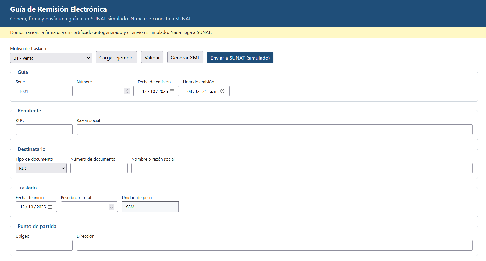
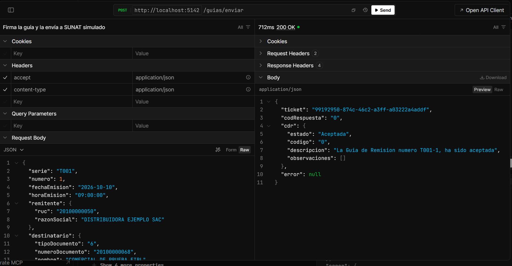

# Generador de Guía de Remisión Electrónica (GRE) — Perú

En Perú, cuando una empresa traslada mercadería (una venta, una compra, un envío entre sus locales), los bienes
deben viajar acompañados de una **Guía de Remisión Electrónica**: un documento XML firmado digitalmente que se
envía a SUNAT y que SUNAT acepta o rechaza.

Este proyecto recibe los datos de una guía, revisa las reglas de SUNAT, genera el XML en el formato oficial
(UBL 2.1), lo firma, lo empaqueta y lo "envía" a un **SUNAT simulado** que responde igual que el real.
**Nunca se conecta a SUNAT**: en producción, una guía es un documento legal.



> **Estado:** completo. Biblioteca, API y pantalla probadas. Es un proyecto de demostración: ver
> [Qué quedó fuera](#qué-quedó-fuera).

## Qué es una guía de remisión, en corto

- **Quién la emite:** el *remitente*, la empresa dueña de la mercadería, antes de que el camión salga.
- **Qué dice:** quién envía, quién recibe, por qué se traslada (el *motivo*: venta, compra, entre locales…), desde
  dónde y hasta dónde, qué bienes van, cuánto pesan y quién los lleva (un transportista contratado o vehículos y
  conductores propios).
- **Qué pasa con ella:** se envía a SUNAT como un ZIP con el XML firmado. SUNAT entrega un *ticket* y, al terminar
  de revisarla, una *constancia de recepción* (CDR) que dice si la guía fue aceptada, aceptada con observaciones o
  rechazada.
- **Por qué importa:** si la fiscalización detiene el camión y la guía no existe o fue rechazada, la mercadería se
  puede retener y hay multa.

## Cómo ejecutarlo

Requisitos: [SDK de .NET 9](https://dotnet.microsoft.com/download/dotnet/9.0) y, para la pantalla,
[Node.js](https://nodejs.org/) 20 o superior. No necesita base de datos, certificado ni credenciales.

```bash
git clone https://github.com/rmm-01/gre-xml-pe.git
cd gre-xml-pe
dotnet run --project src/GreXml.Api --launch-profile http
```

En otra terminal, la pantalla:

```bash
cd web
npm install
npm start
```

- **Pantalla:** `http://localhost:4200`. Elegir un motivo, *Cargar ejemplo* y *Enviar a SUNAT (simulado)*.
- **API sola:** `http://localhost:5142` redirige a Scalar, donde se prueban los endpoints.

### Qué probar en la pantalla

| Acción | Resultado |
|---|---|
| *Cargar ejemplo* y *Validar* | La guía cumple todas las reglas |
| Borrar la serie o poner cantidad 0 en un bien, y *Validar* | El error aparece junto al campo, con su código propio y el de SUNAT |
| *Generar XML* | El XML firmado, si cumple el esquema, si la firma es válida y el ZIP para descargar |
| *Enviar a SUNAT (simulado)* | Ticket y CDR **aceptada** |
| Cambiar la placa a `ZZZ123` y enviar | CDR **observada** (4398: placa no registrada) |
| Enviar dos veces la misma guía | **Rechazo** antes del ticket (2223: ya fue presentada) |
| Elegir el motivo 02 | Aparece la sección del proveedor |
| Cambiar la modalidad a *Público* | Se pide el transportista en lugar de vehículos y conductores |



## Qué hace, paso a paso

```
datos de la guía ─► validar reglas ─► generar XML ─► firmar ─► validar XSD ─► ZIP + hash ─► SUNAT simulado ─► CDR
                    (códigos SUNAT)   (UBL 2.1)    (XMLDSig)                                 (ticket)         (aceptada,
                                                                                                               observada
                                                                                                               o rechazada)
```

| Endpoint | Qué hace |
|---|---|
| `GET /guias/ejemplo?motivo=01` | Una guía válida con datos inventados (motivos 01, 02 y 04) |
| `POST /guias/validar` | Todos los errores juntos, cada uno con su código y el campo exacto |
| `POST /guias/generar` | XML firmado, si cumple el esquema, si la firma es válida, y el ZIP listo para enviar |
| `POST /guias/enviar` | Lo anterior y el envío al SUNAT simulado: ticket y respuesta (CDR) |
| `GET /envios/{ticket}` | Consulta un envío que seguía en proceso |

Ejemplo de error de validación (`POST /guias/validar`):

```json
{
  "valida": false,
  "errores": [
    { "codigo": "GRE-201", "codigoSunat": "3343", "campo": "fechaInicioTraslado",
      "mensaje": "La fecha de inicio del traslado no puede ser anterior a la fecha de emisión." },
    { "codigo": "GRE-208", "codigoSunat": null, "campo": "bienes[1].cantidad",
      "mensaje": "La cantidad debe ser mayor que cero." }
  ]
}
```

## Motivos de traslado soportados

| Código | Motivo | Regla principal |
|---|---|---|
| 01 | Venta | El destinatario (comprador) es otra persona (SUNAT 2555) |
| 02 | Compra | El destinatario es el propio remitente y se informa al proveedor (SUNAT 2554, 4375) |
| 04 | Traslado entre establecimientos de la misma empresa | El destinatario es el remitente y la llegada es otro local |

SUNAT define 14 motivos. Agregar uno es agregar una clase con sus reglas: el XML, la firma y el envío no cambian.

## Decisiones técnicas (resumen)

- **Cada regla tiene un código propio y, si existe, el código de error de SUNAT.** Algunas reglas son propias
  (por ejemplo, peso mayor que cero) y lo indican con `codigoSunat: null`.
- **El XML se valida contra los esquemas oficiales UBL 2.1 de OASIS**, incluidos dentro de la biblioteca: la validación
  no depende de internet.
- **Firma XMLDSig "enveloped" con RSA-SHA256**, dentro de `ext:UBLExtensions`. Después de firmar, el XML no se
  reformatea: un espacio de más invalida la firma.
- **Certificado de demostración creado en memoria.** Firma de verdad, pero ninguna entidad lo respalda. El repositorio
  no guarda ningún `.pfx` ni contraseña.
- **El envío está detrás de una interfaz (`IEnvioSunat`).** El simulador revisa nombre, hash, esquema y firma, y
  responde con los códigos de SUNAT (por ejemplo, 2335 si el documento fue alterado). Una implementación real solo
  tendría que reemplazar esa pieza.
- **Seguridad al leer XML y ZIP:** sin DTD ni entidades externas (protección contra XXE) y con límite de tamaño al
  descomprimir.
- **La pantalla no repite las reglas.** Angular solo arma el JSON y muestra lo que responde la API: cada error trae la
  ruta del campo (`bienes[1].cantidad`) y se marca en ese campo. Las reglas viven en un solo lugar, el backend.

## Qué quedó fuera

Es una demostración. Para emitir guías reales faltaría:

- **Envío real a SUNAT.** Requiere credenciales del contribuyente (clave SOL y un cliente registrado) y la
  implementación de `IEnvioSunat` contra la API de SUNAT, incluido el token OAuth2. El simulador reproduce el ciclo
  de envío, ticket, consulta y CDR, pero no la autenticación.
- **Certificado digital real.** La firma usa un certificado autogenerado en memoria. En producción se usa el
  certificado del contribuyente, registrado en SUNAT y guardado fuera del repositorio.
- **CDR firmado por SUNAT.** El CDR simulado no lleva la firma de SUNAT, así que no se verifica.
- **Códigos de error verificados.** Los códigos de SUNAT vienen de un catálogo público de un proveedor de facturación
  electrónica, no del archivo oficial de SUNAT. La estructura del XML se validó con el esquema de OASIS, pero no se
  comparó línea por línea con la guía de elaboración de SUNAT.
- **Los otros 11 motivos de traslado**, la guía del transportista (tipo 31) y los documentos relacionados, como la
  factura de la venta.
- **Persistencia.** Nada se guarda: los envíos viven en memoria y se pierden al reiniciar la API.

## Estructura

```
src/
  GreXml.Core/   Modelo, reglas, XML, XSD, firma, empaquetado y SUNAT simulado (sin dependencia de ASP.NET)
  GreXml.Api/    Minimal API
tests/
  GreXml.Tests/  Pruebas con xUnit
web/             Pantalla en Angular 21 (formulario, errores por campo, XML, ZIP y CDR)
```

## Pruebas

```bash
dotnet test
cd web && npm test
```

- **Backend: 154 pruebas**, sin acceso a internet: una por cada regla, el XML leído con XPath, el esquema, la firma
  (incluida la detección de un dato alterado), el ciclo de envío con cada código de error y la API de punta a punta.
- **Pantalla: 40 pruebas** con Vitest: el servicio HTTP, la conversión entre el formulario y la guía, las rutas de los
  errores (`bienes[1].cantidad` a `bienes.1.cantidad`), la descarga del ZIP y cada panel de resultado.

## Licencia

Código bajo licencia [MIT](LICENSE). Los esquemas de `src/GreXml.Core/Esquemas/` son de OASIS y conservan su propio
aviso de copyright (ver [LEEME](src/GreXml.Core/Esquemas/LEEME.md)).
